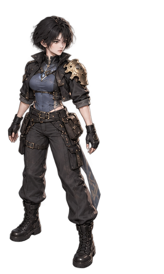
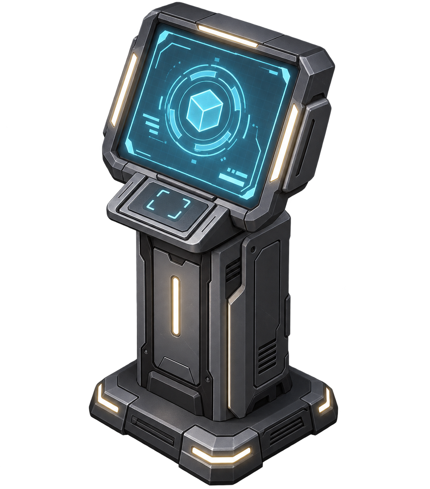
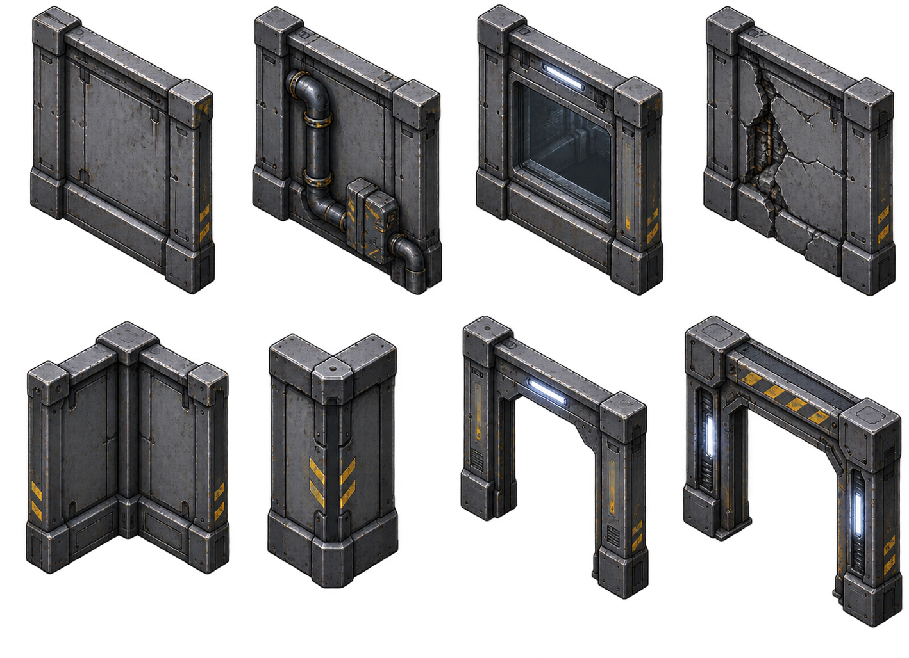
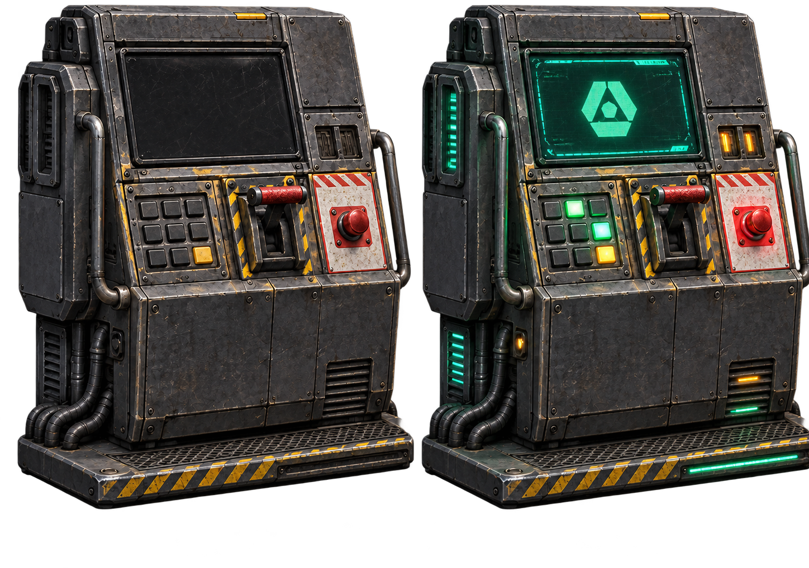
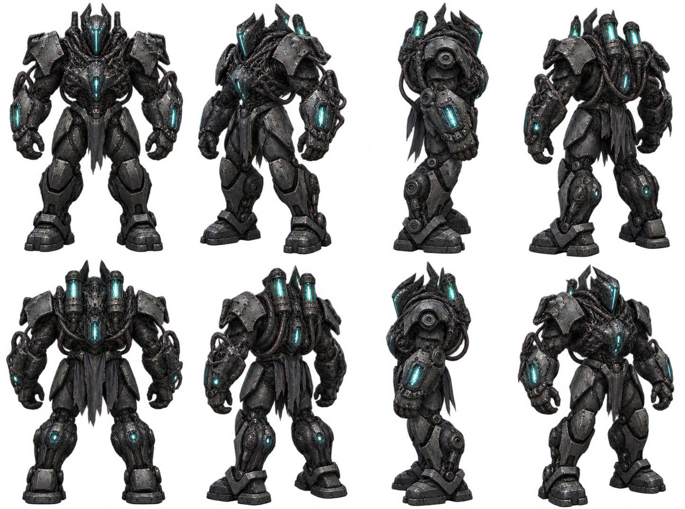
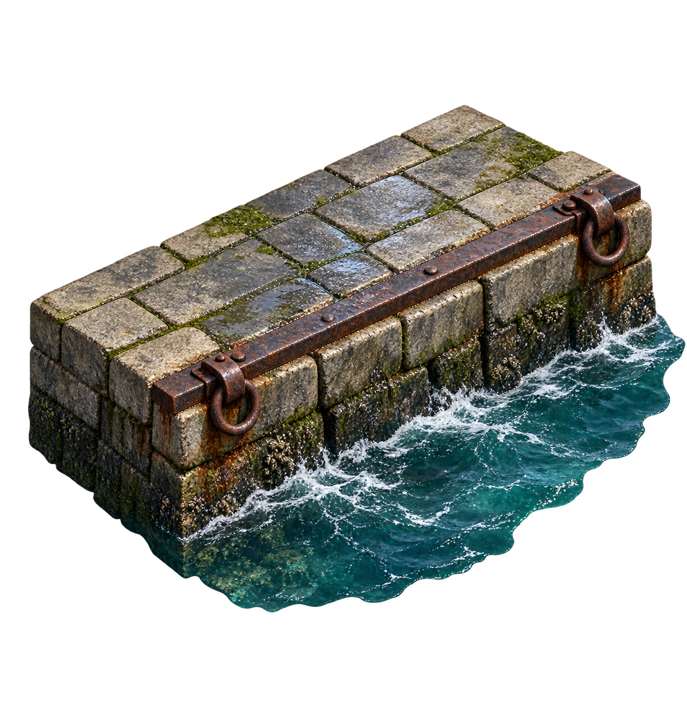
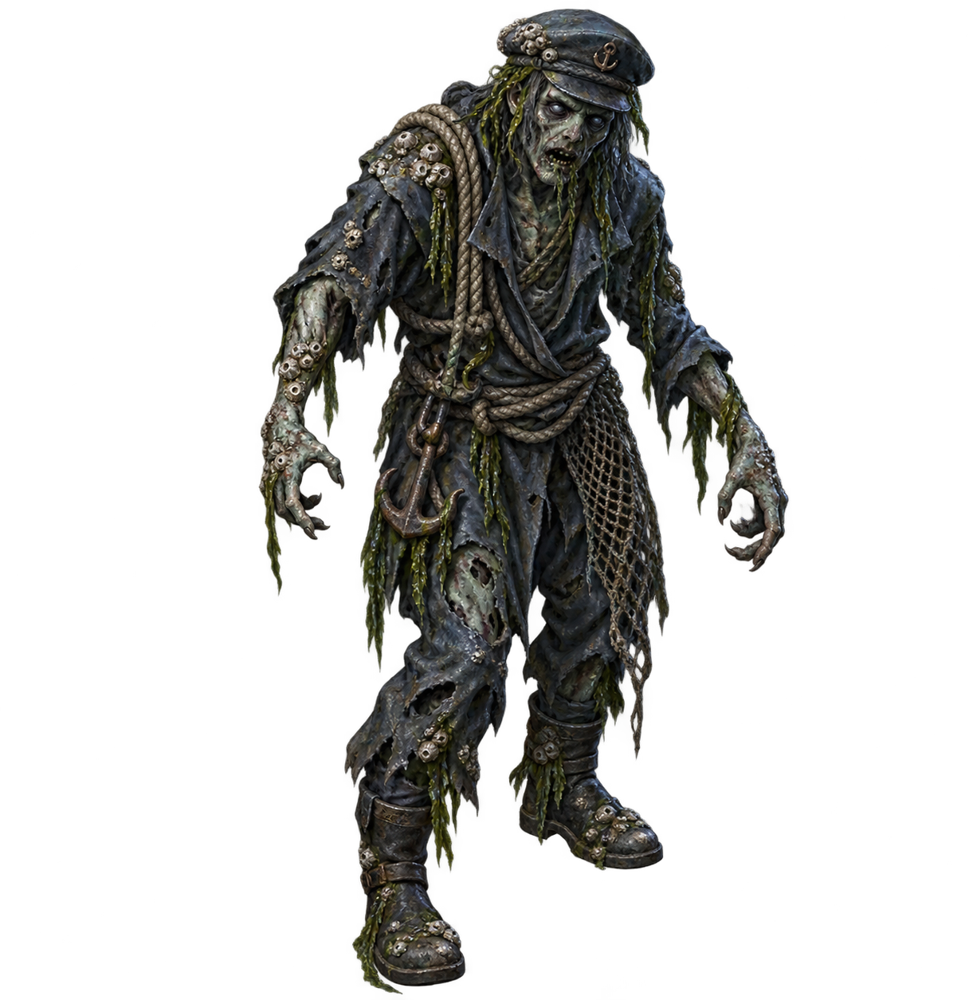
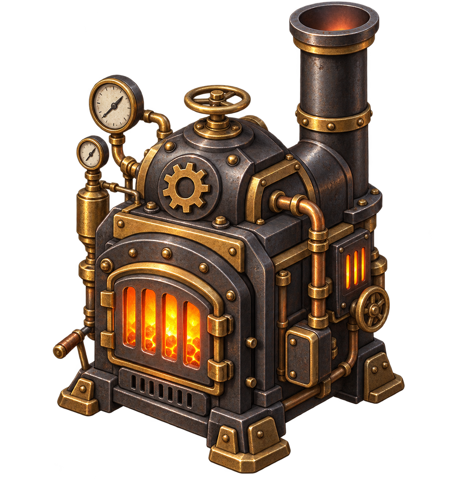
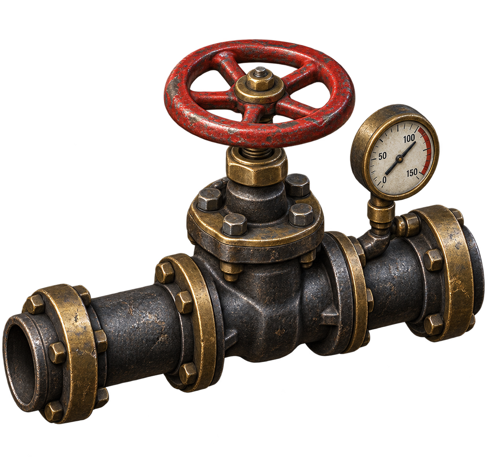

# 美术图录

[目录](README.md) · [世界](worlds.md) · [人物](characters.md) · [成长](gameplay.md) · [美术图录](art-catalog.md)

这里按人物、设施、世界材质、敌人与界面组织作品的视觉语言。图像在各章中与相应的世界和对象相邻，帮助读者从整体气质走近具体结构。

## 人物与装备

*岑遥 · 短发、深色实用服装与非对称装备结构*

人物的服装与配件强调可穿戴、可维护的真实感。织物与金属在明暗和边缘上相互区分，重要标识保持克制。

## 归航站的设备

*归航站 · 终端外壳与屏幕结构*

终端的功能通过外形、屏幕与身份符号组织。南北服务区域与通路共同建立房间秩序，设备不应吞没人物活动的空间。

## 灰巢的设施语言

*灰巢 · 墙板与结构接缝*

*灰巢 · 动力控制台*

*灰巢 · 自动防卫哨卫*

冷金属、墙板分缝、管线和功能设备共同构成设施内部。控制台与防卫单元的造型，需要让人辨认它们各自的职责。

## 雾港的边界与威胁

*雾港 · 湿石、水边与岸线层次*

*雾港 · 溺亡者*

雾与湿润表面降低远处的确定性，近处轮廓仍须清楚。水边既塑造气氛，也帮助理解行进空间。

## 钟骨的压力与热

*钟骨 · 炉体*

*钟骨 · 压力管路阀门*

厚重设备依靠结构、磨耗与局部热光建立尺度。机械的轮廓与连接关系比装饰性的光效更重要。

## 远方的世界

倒影界的星海、沙丘魔海的绿潮与遗泽的矩阵大厅构成三种截然不同的空间经验。完整图像与世界叙述见[门后的世界](worlds.md)。

## 图像阅读

本集使用人物造型、环境插画与物件设计图讲述作品的视觉世界。图像的作用由各页题注说明；它们不作为游戏运行画面的记录。
