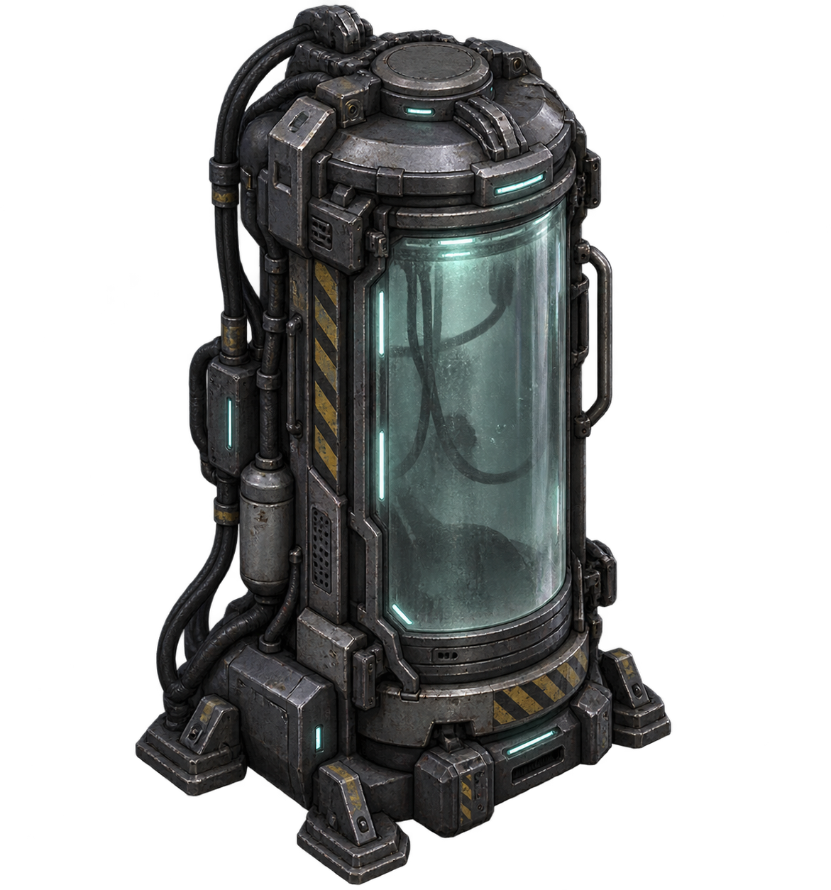

# 旅人

[目录](README.md) · [世界](worlds.md) · [人物](characters.md) · [成长](gameplay.md) · [美术图录](art-catalog.md)

## 岑遥

*岑遥 · 人物造型*

岑遥是这段旅程的中心。她以普通探索者的身体和感知进入未知世界，逐步获得超出原有经验的能力。人物的变化首先来自行动与认识，而不是开局就拥有无所不知的视野。

短黑发、炭灰短外套、青灰内层、深色工装裤和工业靴，构成她清楚而克制的轮廓。单侧结构与胸前标识打破对称，使人物即使缩小到场景尺度，也保有可辨认的身份。

她的装备语言从实用的人类技术出发。金属、织物、连接件和随身配件应让人相信它们可以被穿戴、使用和维护。随着旅程展开，超自然能力逐渐进入这个最初朴素的形象。

## 同一个人，不同的起点

智力、体力与精神力描述的是同一主角的初始倾向。它们改变起步时的优势与成长侧重，并不把旅人分成彼此隔绝的职业。

### 智力者

以学习与理解见长。技能熟练度的积累和知识的运用，是这一倾向的重要表现。

### 体力者

更侧重身体基础。体素相关的生命与环境耐受等能力，体现身体成长带来的连锁收益。

### 精神力者

以较高的初始精神力与精神强化收益形成差异。涉及精神探测的能力，仍有各自需要满足的条件。

三种起点共用技能、道具与血统体系。不同的面板影响何时达到条件、怎样安排投入，不另设只有某一身份能够访问的技能商店。

## 白芷

*灰巢 · 生物隔离设施*

白芷出现在灰巢的生物隔离区。她使冰冷的设施调查出现一个具体的人：面对警告与请求，岑遥需要决定是否答应帮助，或者将她留在那里。

承诺与结果之间并不划等号。答应帮助是旅人作出的选择，而灰巢的供电、封锁与主线通路仍遵循各自的因果。

## 人物与世界的尺度

人物不应被环境细节淹没。角色轮廓、衣饰重心与动作朝向需要在斜视空间中保持清楚；配件和装备应从属于人物，而不是将她变成一组堆叠的发光符号。

敌人的造型同样服务于识别：感染维护工保留设施人员的职业痕迹，哨卫展现自动防卫的重量，雾港异形与钟骨铸造机械则分别嵌入所在世界的材质与威胁语言。
