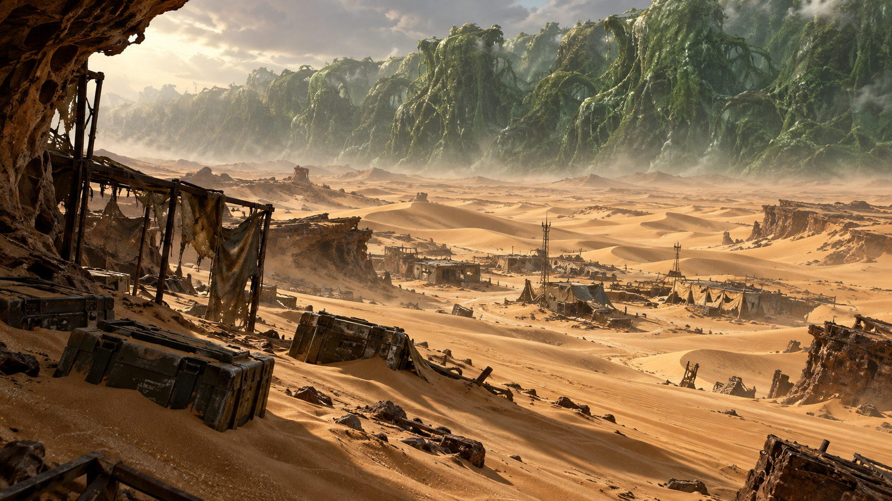
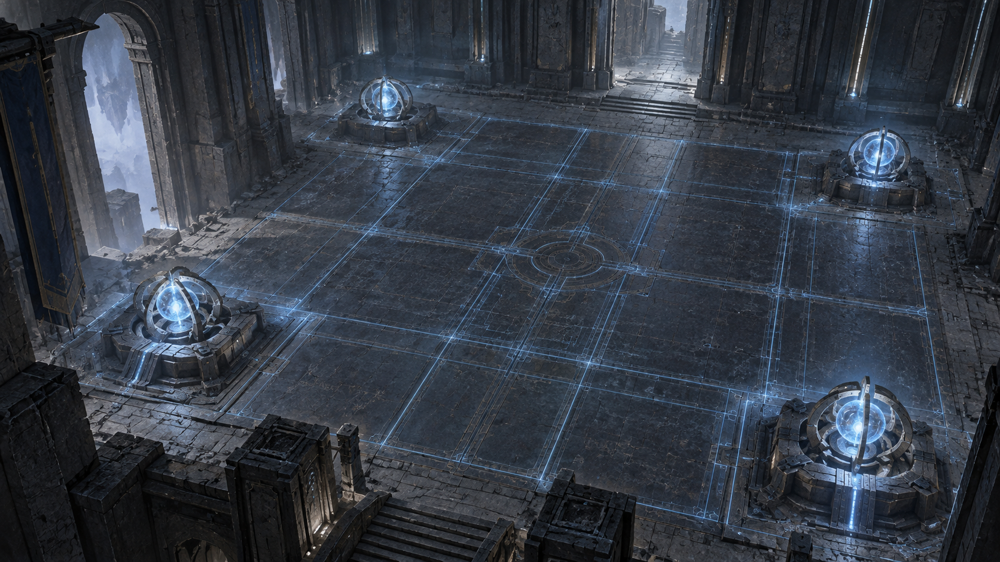

# 门后的世界

[目录](README.md) · [世界](worlds.md) · [人物](characters.md) · [成长](gameplay.md) · [美术图录](art-catalog.md)

## 归航站

归航站是一座服务于出发与返回的小型技术中继站。世界门、任务终端、能力整备和储物空间围绕清楚的通路展开。它的可靠感来自可理解的结构与功能：墙体有厚度，设备有脚点，光照有来源。

暗钢、蓝灰与少量温暖光线让这里成为旅途的停靠点。它不需要像城市一样宏伟，却需要让每一次返回都能辨认自己所处的位置。

## 灰巢设施 · B-17 回收层

灰巢的空间围绕供电、门控、隔离与防卫组织起来。冷凝、管缆、金属壁板和生物安全设备构成它的表面；失常的运行秩序则构成探索的压力。

旅程从维护入口深入主电室，穿过 Gate A 与中央竖井，再接近封锁控制和生物隔离区。Gate B 之后，深层消杀与自动防卫把设施的危险推向更直接的对抗。信标与出口，将这次深入重新连接到归航的方向。

空间节点：维护入口、主电室、Gate A、中央竖井、封锁控制区、生物隔离区、Gate B、深层消杀区、哨卫区域、信标室、出口。

## 雾港余烬

雾港的道路与水、石岸和信号纠缠在一起。视线会衰减，声音会穿过看不清的空间，水域则改变前进的代价。低饱和冷光照着湿石与旧金属，让近处细节与远处不确定性同时存在。

*雾港 · 石岸与水域边界*

从雾中码头进入潮汐仓库与信号场，旅人沿沉没岸台和防波堤寻找定位依据。泵站、共鸣塔与守望者区域，使水位、声音与威胁相互关联，最终通向撤离点。

空间节点：雾中码头、潮汐仓库、信号场、沉没岸台、防波堤、泵站、共鸣塔、守望者区域、撤离点。

## 钟骨工厂

没有人员值守的生产线仍在运转。暗钢结构、蒸汽、炉光与压力管道，使钟骨工厂像一套仍未停下的庞大机构。地面也并非永远静止，输送表面和垂直机械让空间带有节奏。

*钟骨 · 炉体与工业设备*

铸造入口连接压力大厅、输送桥和锅炉室。齿轮竖井将旅程引向垂直方向，炉心、铸造卫士区域与调节核心逐渐揭示这座工厂的运行强度，停机出口则成为这一段旅程的收束。

空间节点：铸造入口、压力大厅、输送桥、锅炉室、齿轮竖井、炉心、铸造卫士区域、调节核心、停机出口。

## 异位面·倒影界

倒影界将熟悉的自然关系轻轻翻转。逆流之河、倒悬草地与静止的雨组成平原的第一层奇观；荧光石林与水晶回廊把光与声音带向更深处。

*倒影界 · 倒悬星海与界域阙*

到了星海，脚下与头顶都向辽阔的星空敞开。远处的界域阙没有门扇，拱内如一条安静竖立的光河。这里的魅力来自自由漫游和奇观，而不是急于将一切转成灾难的征兆。

地域层次：F1 倒映平原；F2 荧光石林；F3 倒悬星海。

## 沙丘魔海

沙丘魔海以干燥与繁生之间的冲突建立自己的尺度。黄沙磨损人造结构，废墟半埋于地表，而远处的绿潮像生物性的幕墙压向地平线。

*沙丘魔海 · 营地 B 与绿潮地平线*

穿梭机残骸是旅途的起点。穿过风蚀隧道，真正的沙地、废屋和半埋补给箱逐渐展开；绿潮与更深处的共生体母巢、洞穴构成另一种生存空间。风景的宏大与近处补给的有限，形成持续的张力。

地域层次：F1 坠毁穿梭机残骸；F2 沙漠地表与绿潮战场；F3 共生体母巢；F4 沙丘洞穴。

## 遗泽

遗泽以古老建筑与精密能量设施并置。尘埃、风化与厚重结构说明时间的存在，仍可辨认的网格、核心与引擎则保留着用途的痕迹。

*遗泽 · 中庭能量矩阵大厅*

冷蓝网格铺展在大厅地面，四角的四枚核心微微发光。中央空间保持开阔，让建筑的尺度与能量结构的秩序一眼可读。更深处的电池库、档案馆、守卫引擎库和圣所，将这片遗迹分成不同层次。

地域层次：F1 尘封巨门前厅；F2 中庭与能量矩阵大厅；F3 守卫引擎库；F4 遗泽圣所。
